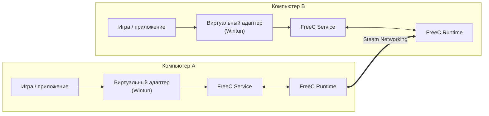

<div align="center">


<br/>

### Виртуальная LAN через Steam. Без VPN-сервера, без проброса портов.

<br/>

[](https://github.com/saberkovich/FreeCTier/releases/latest)
[](https://github.com/saberkovich/FreeCTier/releases)
[](LICENSE)


</div>

<br/>

## Скачать

<div align="center">

<a href="https://github.com/saberkovich/FreeCTier/releases/latest/download/FreeC-Tier_x64-setup.exe">
  
</a>
&nbsp;
<a href="https://github.com/saberkovich/FreeCTier/releases/latest/download/FreeC-Tier_x64-portable.zip">
  
</a>

<sub>Windows 10 / 11 · x64 · нужен запущенный Steam · <a href="https://github.com/saberkovich/FreeCTier/releases">все релизы</a></sub>

</div>

<br/>

## Что это

**FreeC Tier** создаёт виртуальную локальную сеть между компьютерами поверх инфраструктуры Steam. Друзья и устройства видят друг друга так, будто они сидят в одной LAN - без собственного VPN-сервера, ручной настройки портов и проброса NAT.

Подходит для:

- 🎮 игр "по локалке", которые не умеют в интернет;
- 🧪 тестирования сетевых приложений на нескольких машинах;
- 🖧 любых сценариев, где компьютерам нужно видеть друг друга как устройства одной сети.

## Как это работает



1. Вы создаёте сеть или входите в существующую - GUI общается с рантаймом.
2. Рантайм устанавливает соединение с участниками через Steam.
3. Системная служба поднимает виртуальный сетевой адаптер и пропускает через него IP-пакеты.
4. Приложения работают с обычной локальной сетью и не знают о существовании Steam.

## Архитектура

Проект - Cargo workspace из нескольких крейтов плюс Tauri-интерфейс.

```
FreeCTier/
├─ client/
│  ├─ core/       freec-core     Конфигурация, хранилище, пакеты, ed25519-ключи, argon2
│  ├─ ipc/        freec-ipc      Протокол обмена между GUI/рантаймом и службой
│  ├─ runtime/    freec-runtime  Интеграция со Steam (steamworks), логика сети
│  ├─ service/    freec-service  Windows-служба: Wintun-адаптер, named pipe, установка
│  └─ gui/                       Интерфейс: Tauri 2 + Vite + TypeScript
│     └─ src-tauri/              Rust-часть приложения
└─ .github/workflows/            Сборка, тесты и выпуск релизов
```

| Слой | Технологии |
|---|---|
| Ядро | Rust 2021, `serde`, `ed25519-dalek`, `argon2`, `sha2` |
| Steam | [`steamworks`](https://crates.io/crates/steamworks) |
| Сеть | [`wintun`](https://crates.io/crates/wintun), `windows-service`, Win32 API |
| Интерфейс | Tauri 2, Vite 7, TypeScript, `morphdom` |
| Шрифты | Unbounded, Onest, JetBrains Mono |
| Тесты | `cargo test`, Playwright |

<br/>

## Сборка из исходников

**Требования:** Windows 10/11 x64 · Rust ≥ 1.90 · Node.js 22 · Steam

```bash
git clone https://github.com/saberkovich/FreeCTier.git
cd FreeCTier

# интерфейс
npm --prefix client/gui ci
npm --prefix client/gui run build

# проверки
cargo fmt --all -- --check
cargo clippy --workspace --all-targets --locked -- -D warnings
cargo test --workspace --locked
npm --prefix client/gui test        # Playwright
```

Режим разработки интерфейса:

```bash
npm --prefix client/gui run dev     # Vite на 127.0.0.1
npm --prefix client/gui run tauri dev
```

Релизы собирает GitHub Actions по тегу `v*`: проверки → portable-сборка → подписанный установщик и манифест обновлений → публикация в [Releases](https://github.com/saberkovich/FreeCTier/releases).

<br/>

## Переводы

Интерфейс доступен на русском и английском. При первом запуске язык выбирается по Windows: русский — для русского интерфейса системы и для стран бывшего СССР, кроме Прибалтики; для остальных — английский. Сменить язык можно в окне «Настройка FreeC Tier» и в настройках.

Все строки лежат в `locales/<язык>.json` — плоские пары `"раздел.ключ": "текст"`, источник — `en.json`. Синхронизация с [Crowdin](https://crowdin.com) настроена в `crowdin.yml`: новый файл из `crowdin download` попадает в следующую сборку без правок кода, вместе с флагом. Подстановки вида `{name}` переводить нельзя — тест `every_locale_parses_and_matches_the_source` не пропустит файл, где они потерялись.

<br/>

## Статус

> [!WARNING]
> **Проект в разработке.** Текущая версия - прототип: функции и поведение сети могут меняться.

<br/>

## Лицензия

[MIT](LICENSE) © 2026 Kirill Dunaev

<div align="center">
<sub>Сделано на Rust 🦀 · Работает на Steam</sub>
</div>

<div align="center">
<sub>❤️ Made with Claude</sub>
</div>
